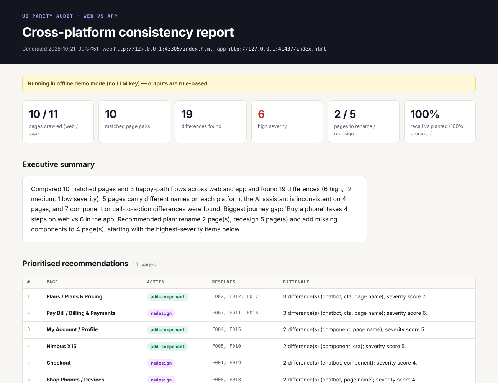
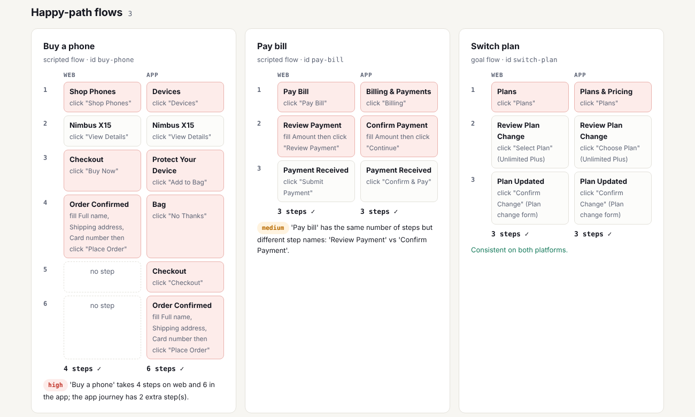
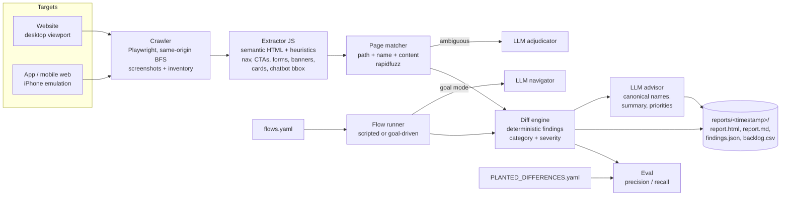

# UI Parity Agent

**An agent that crawls a company's website and its mobile app, matches every page across the two, runs the same happy-path journeys on both, and produces a prioritised standardisation backlog of every inconsistency: page names, AI chatbot placement, components, CTAs and flows.**

   
<!-- Replace saranyabalantrapu123-cmd once the repo is public: https://github.com/saranyabalantrapu123-cmd/ui-parity-agent -->

## Why this matters

Large consumer brands ship the same experience on two platforms built by different teams. Over time they drift apart: the website says **"Pay Bill"** and the app says **"Billing & Payments"**, the AI assistant floats bottom-right on one platform and hides in a header on the other, and buying a phone takes 4 steps on web but 6 in the app. Customers notice, support scripts break, and analytics can't compare funnels.

Finding those differences by hand means designers clicking through hundreds of screens with spreadsheets. An agent like this one turns it into a repeatable audit:

- **Cross-platform consistency.** Every page pair is compared on the same checklist (name, assistant placement, components, CTAs) and every key journey is executed end to end on both platforms.
- **Faster audits.** A full crawl, flow run and report takes seconds per page instead of days of manual review, and can be re-run after every release.
- **A single source of truth for design and engineering.** The output is a backlog (`rename`, `redesign`, `add-component`) with a proposed standard name for each mismatch, ready to import into a tracker.

The original version of this agent, built on a real product, drove the **standardisation of 96 page names and the redesign of 25 pages**. This repository re-creates the approach from scratch on a fictional brand.

## Demo

`docs/demo.gif`: *add your recording here* (e.g. `make app`, click **Run audit**, browse the Pages tab).

Real output of `make demo` (offline mode), rendered from `reports/<timestamp>/report.html`:





## Architecture



All LLM calls go through one wrapper (`parity_agent/llm.py`, LiteLLM). Every call site also supplies a rule-based fallback, so with no API key the whole pipeline runs offline with a `MockLLM`.

## Quickstart

Offline demo, no API key and no network needed:

```bash
make setup          # pip deps + Playwright Chromium (SKIP_BROWSER_INSTALL=1 if Chromium is already installed)
make demo           # serves the bundled web + app demo sites locally, audits them -> reports/<timestamp>/
make app            # Streamlit UI: run audits and browse reports
```

`make test` runs the offline test suite and `make eval` scores the agent against the planted ground truth.

With a real model:

```bash
cp .env.example .env            # set ANTHROPIC_API_KEY (default model: anthropic/claude-sonnet-4-5)
python -m parity_agent run --demo
python -m parity_agent run --web https://www.example.com/ --app https://m.example.com/ --flows my_flows.yaml --max-pages 50
```

The run prints token usage and estimated cost, and the report footer records them. Docker: `make docker-build && make docker-run` (based on `mcr.microsoft.com/playwright/python`).

## How it works

| Stage | What it does | Where |
|---|---|---|
| **Serve** | The demo sites are served from background `http.server` threads on two separate origins. | `server.py` |
| **Crawl** | Breadth-first and same-origin, nav links first, with query/fragment normalisation and a `--max-pages` cap. The web crawl uses a 1366x900 desktop viewport. The app crawl uses an iPhone-class mobile context (390x844, touch, mobile UA). Each page gets a full-page screenshot. | `crawler.py` |
| **Extract** | In-page JS inventories the main content: CTAs (buttons, button-styled links), forms with field labels, banners, cards, named sections, headings and nav labels. It reads semantic HTML first (`main`, `nav`, `header`, `aria-label`, `<form>`, `<article>`) and falls back to class/id/text heuristics (`*-card`, `promo-*`, `btn`, `cta-*`). It never relies on `data-` attributes. | `js/extract.js` |
| **Chatbot detection** | Candidates are found by id/class/aria/iframe title (`chat`, `assistant`, `intercom`, `drift`, `zendesk`, ...) or by launcher text ("Ask Nova", "Live chat"). Links inside `<nav>` are ignored. The outermost element's bounding box and layout give a normalised position: `floating-bottom-right`, `floating-bottom-left`, `header`, `inline` or `absent`. | `chatbot.py` |
| **Match pages** | `0.2 * path + 0.3 * name (H1 or nav label) + 0.5 * content (Jaccard over components)`. Confident, unambiguous pairs are accepted greedily. Leftovers go to the LLM with their top 3 candidates. Offline, a rule accepts only strong content or name agreement. | `matcher.py` |
| **Flows** | `flows.yaml` supports **scripted** steps (click by accessible name or selector, fill by label) and **goal** mode, where only a goal and a start page are given. In goal mode the LLM picks each click. Offline, it uses keyword overlap with the goal plus a bonus for "confirm/continue" verbs. The runner records every step's action, URL and page name. | `flows.py` |
| **Diff** | Deterministic findings in six categories: `page_name`, `chatbot`, `component` (incl. form fields), `cta`, `flow`, `coverage`. Each finding has a severity and an action. A missing component suppresses the CTAs and forms nested inside it, and repeated relabels are grouped, so one root cause produces one finding. | `diff.py` |
| **Advise (LLM)** | Proposes a canonical name for each page-name or CTA mismatch and writes the executive summary and page-level recommendations (`rename`, `redesign`, `add-component`). Offline: preferred-vocabulary rule, then the shorter/clearer label in Title Case, plus a templated summary. | `advisor.py` |
| **Report** | `report.html` (self-contained: inline CSS, base64 screenshots side by side, filterable findings, flow comparison), `report.md`, `findings.json`, `standardization_backlog.csv`, `pages.json`, and `eval.json` for demo runs. | `report.py` |

**Guardrails**
- The LLM never creates or deletes findings. Findings come only from the deterministic diff engine, and the LLM only names, summarises and prioritises them.
- LLM answers must be JSON. Matcher answers must pick one of the offered candidates, and recommendation actions are checked against an allowed set. Any failed or unparseable call falls back to the rule-based answer.
- The crawler stays on the start origin, skips non-HTML assets and failing URLs, and respects the page cap. A broken flow step is reported as a `flow` finding instead of crashing the run.
- In offline mode a banner ("Running in offline demo mode (no LLM key) — outputs are rule-based") appears in the CLI, the reports and the Streamlit app.

## Evaluation

The bundled **Nimbus Wireless** demo has a web site (`demo_sites/web`, desktop) and an "app" (`demo_sites/app`, mobile layout with a bottom tab bar), with about 10 matching pages each. 19 realistic differences are planted between them and listed in [`demo_sites/PLANTED_DIFFERENCES.yaml`](demo_sites/PLANTED_DIFFERENCES.yaml). Examples: "Pay Bill" vs "Billing & Payments", the assistant missing from app Plans, a web-only trade-in widget, "Select Plan" vs "Choose Plan", and buy-a-phone taking 4 steps on web vs 6 in the app. The ground truth also names things that are deliberately identical, and any finding about them counts as a false positive.

Measured with `make eval` in offline mode (deterministic, so the numbers are reproducible):

| Category | Planted | Reported | Precision | Recall |
|---|---:|---:|---:|---:|
| page_name | 5 | 5 | 1.00 | 1.00 |
| chatbot | 4 | 4 | 1.00 | 1.00 |
| component | 4 | 4 | 1.00 | 1.00 |
| cta | 3 | 3 | 1.00 | 1.00 |
| flow | 2 | 2 | 1.00 | 1.00 |
| coverage | 1 | 1 | 1.00 | 1.00 |
| **overall** | **19** | **19** | **1.00** | **1.00** |

Read these numbers as a regression check, not a benchmark. The demo sites and the ground truth were written together with the agent, so a perfect score shows that the pipeline works end to end and stays deterministic. It does not show how well the agent generalises to arbitrary production sites. The tests require recall and precision of at least 0.9 overall.

LLM-dependent quality (canonical names chosen by a real model, summary usefulness, goal-mode navigation and page-match adjudication on real sites) has **not** been measured. Run `make eval` with your key to fill this in.

## Tech stack

Python 3.11+ · Playwright (Chromium) · rapidfuzz · LiteLLM (Anthropic / OpenAI) · Jinja2 · Pillow · PyYAML · Streamlit · pytest · Docker

```
parity_agent/
  cli.py          python -m parity_agent run | eval
  pipeline.py     orchestration
  server.py       local demo-site servers
  crawler.py      Playwright BFS crawler + snapshots
  js/extract.js   in-page component / chatbot inventory
  js/candidates.js clickable elements for goal-mode flows
  chatbot.py      position normalisation
  matcher.py      cross-platform page matching (+ LLM fallback)
  flows.py        flows.yaml loader + runner (scripted / goal)
  diff.py         deterministic diff engine
  advisor.py      canonical names, summary, recommendations
  llm.py          LiteLLM wrapper + MockLLM + usage/cost tracking
  evaluate.py     precision / recall vs planted differences
  report.py       html / md / json / csv writers
demo_sites/       Nimbus Wireless web + app, PLANTED_DIFFERENCES.yaml
flows.yaml        happy-path flows for the demo
app.py            Streamlit UI
tests/            offline pytest suite
```

## Data source and license

All data is synthetic. "Nimbus Wireless" is a fictional carrier, and every page, price and person in `demo_sites/` was written for this project. Code is MIT-licensed (see [LICENSE](LICENSE)). When auditing real sites, respect their terms of service and robots policies and keep `--max-pages` modest.

## Disclaimer

Personal portfolio project built with public/synthetic data. Not affiliated with any employer.
